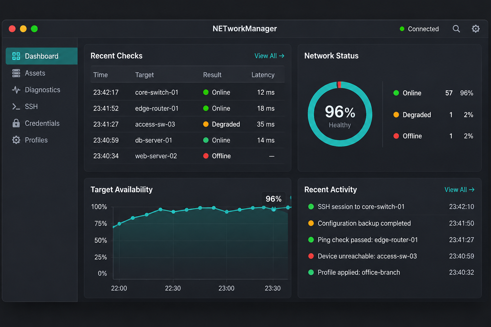
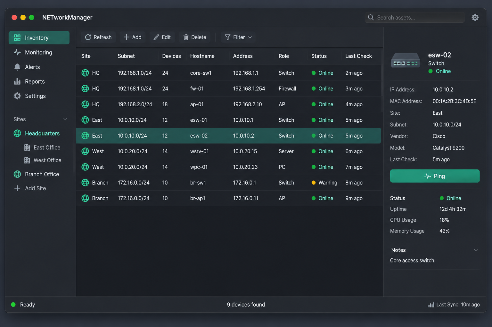
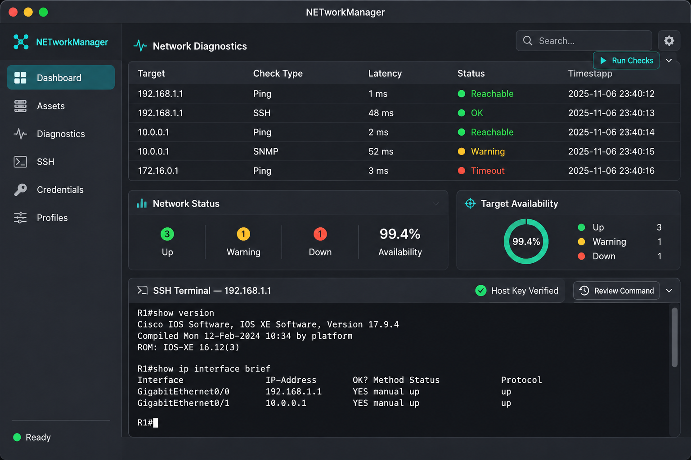

# NETworkManager for macOS

**面向网络工程与运维人员的原生 macOS 网络工作台。**<br>
**A native macOS network operations workbench for network engineers and administrators.**

[简体中文](#简体中文) · [English](#english)

## 简体中文

NETworkManager for macOS 是基于 [BornToBeRoot/NETworkManager](https://github.com/BornToBeRoot/NETworkManager) 进行的独立 macOS 适配。上游项目主要使用 C#、WPF 面向 Windows；本仓库的 macOS 应用使用 SwiftUI 和 AppKit 实现，原版 Windows 源码仍保留在 `Source/`。本项目并非上游官方发行版。

应用面向需要集中管理网络资产、执行日常诊断并安全连接设备的网络工程与运维人员。当前 macOS 版本要求 macOS 14 或更高版本。

### 功能概览

- **资产工作区**：本地整理工作区、站点、网段、设备和诊断记录；对设备发起 Ping，并保存结果供后续查看。
- **网络诊断**：提供 Ping、IP/端口扫描、DNS 查询、Traceroute、WHOIS、SNMP 等工具。网络扫描会显示目标范围并支持取消。
- **远程操作**：在应用终端标签页中使用系统 OpenSSH；命令模板和确认流程帮助操作人员检查目标及命令。RDP、VNC 等使用 macOS URL 交接给已安装的客户端。
- **凭据与配置**：秘密值保存在 macOS Keychain；凭据备份仅导出引用信息。配置文件支持 JSON 导入导出及 macOS 版本的加密导出。
- **独立运行**：网络操作由可见的应用进程执行，不安装项目专属常驻守护进程或特权助手。

具体实现范围和平台差异请参阅 [macOS 功能状态与平台映射](macos/PORTING_STATUS.md) 和 [macOS 使用及构建指南](macos/README.md)。

### macOS 界面概念图

以下图片由 **gpt-image-2.5-flare** AI 图像生成模型制作，用于展示本项目设想的运维工作流与视觉方向。它们是**设计概念图，不是当前应用的实测截图**；图片中的文字和数据仅作视觉示意，实际功能以代码和功能状态文档为准。

| 仪表盘 / Dashboard | 资产清单 / Asset inventory |
| --- | --- |
|  |  |
| **概念图**：运行状态、检查结果与近期活动。 | **概念图**：设备清单、状态与资产详情。 |

#### 诊断与 SSH / Diagnostics and SSH



**概念图**：诊断结果与远程终端工作区。以上 UI 画面由 AI 生成，不能作为已实现功能或应用运行效果的证明。

### 构建

需要安装 Xcode Command Line Tools。创建本机 `.app`：

```bash
./macos/Scripts/build-app.sh
```

生成 DMG：

```bash
CREATE_DMG=1 ./macos/Scripts/build-app.sh
```

本机开发构建默认使用 ad-hoc 签名；这不等同于 Developer ID 签名或 Apple 公证。用于分发的正式 Universal DMG、公证步骤和所需凭据见 [macOS 构建与发布指南](macos/README.md)。

### 上游来源与许可证

本项目基于 [BornToBeRoot/NETworkManager](https://github.com/BornToBeRoot/NETworkManager) 进行 macOS 系统适配，保留原项目的来源说明和许可证信息，并独立维护 macOS 原生实现。项目遵循 GPL-3.0；详情见 [LICENSE](LICENSE)。

## English

NETworkManager for macOS is an independent macOS adaptation of [BornToBeRoot/NETworkManager](https://github.com/BornToBeRoot/NETworkManager). The upstream project is primarily a C#/WPF application for Windows. This repository implements the macOS app with SwiftUI and AppKit while retaining the original Windows source under `Source/`. This is not an official upstream release.

The app is designed for network engineers and administrators who need a focused place to organize network assets, run routine diagnostics, and connect to devices securely. The macOS edition requires macOS 14 or later.

### Capabilities

- **Asset workspace**: Organize workspaces, sites, subnets, devices, and diagnostic records locally. Ping a device and keep the result for later review.
- **Network diagnostics**: Use Ping, IP and port scanning, DNS lookup, Traceroute, WHOIS, SNMP, and other tools. Scans preview their target ranges and can be cancelled.
- **Remote operations**: Use system OpenSSH in the app's terminal tabs. Command templates and review prompts help operators check the target and command. RDP and VNC are handed off to installed macOS clients through their URL schemes.
- **Credentials and profiles**: Secret values stay in the macOS Keychain; credential backups contain references only. Profiles support JSON import/export and a macOS-specific encrypted export format.
- **Standalone runtime**: Network operations run in the visible app process. The project does not install a persistent project-specific daemon or privileged helper.

See the [macOS feature and platform status](macos/PORTING_STATUS.md) and the [macOS usage and build guide](macos/README.md) for implementation details and platform-specific limits.

### macOS UI concepts

These images were generated with the **gpt-image-2.5-flare** AI image model to illustrate the intended operations workflows and visual direction. They are **design concepts, not screenshots captured from the running app**. Any text and data shown in the artwork are illustrative; refer to the source code and feature status document for implemented behavior.

| Dashboard | Asset inventory |
| --- | --- |
|  |  |
| **Concept art**: service health, checks, and recent activity. | **Concept art**: device inventory, status, and asset details. |

#### Diagnostics and SSH


**Concept art**: diagnostic results and a remote terminal workspace. AI-generated UI artwork does not establish that a feature is implemented or show the app's actual runtime behavior.

### Build

Install the Xcode Command Line Tools, then create a local `.app` bundle:

```bash
./macos/Scripts/build-app.sh
```

Create a DMG:

```bash
CREATE_DMG=1 ./macos/Scripts/build-app.sh
```

Local development builds use ad-hoc signing by default; this is not Developer ID signing or Apple notarization. See the [macOS build and release guide](macos/README.md) for a distributable Universal DMG, notarization, and required credentials.

### Upstream and license

This project adapts [BornToBeRoot/NETworkManager](https://github.com/BornToBeRoot/NETworkManager) for macOS, retains upstream attribution and license information, and independently maintains the native macOS implementation. The project is licensed under GPL-3.0; see [LICENSE](LICENSE).
