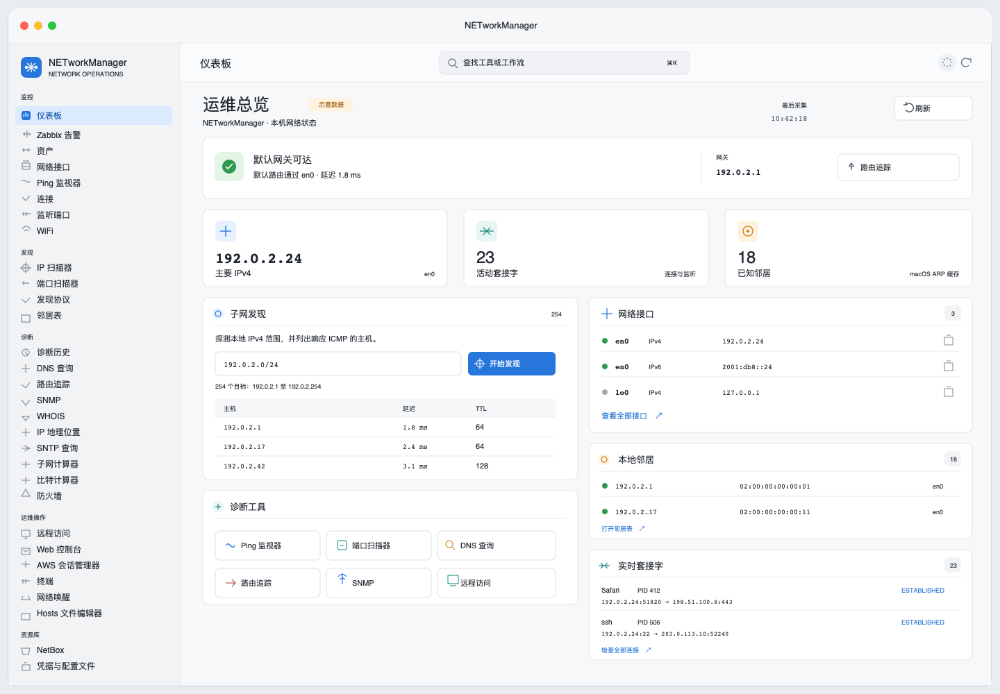

# NETworkManager for macOS

This directory contains the native macOS edition of NETworkManager. The
Windows application in Source/ remains the Windows/WPF product; the macOS
edition is a Swift Package built with SwiftUI and AppKit.

The app includes `NMCP`, which exposes local lookups and selected single-target
diagnostics through MCP over stdio. Install `NETworkManager.app` in Applications,
open **Settings → MCP**, click **Connect Codex**, then start a new Codex chat.
If Codex is not found automatically, **Choose Codex…** lets you select
`Codex.app` or its executable. No terminal setup or Swift toolchain is required
for this connection. See [MCP.md](MCP.md) for other clients, tools, resources,
and developer checks.

MCP is bundled by default; connecting Codex is a one-time user action. The
**Include Ping, DNS, and TCP diagnostics** switch starts on. Changing it requires
**Update Codex connection**; **Disconnect Codex** removes the registration.
NETworkManager may close after connecting, and moving the app requires
reconnecting so Codex can use its new path.

## Interface preview / 界面预览

The following dashboard mockup illustrates the refreshed macOS window and uses
documentation-only example addresses. It is a design preview, not a capture of a
real network. / 以下总览示意图展示了更新后的 macOS 窗口，并使用仅供文档示例
的地址；它是设计预览，不是实际网络截图。



The macOS target requires macOS 14 or later. It uses the existing OUI, ports,
and WHOIS XML data from macos/Sources/NMCore/Resources/ and stores user data
under ~/Library/Application Support/NETworkManager/.

Network clients share a cancellable system DNS-SD address resolver for hostnames
and a numeric-only path for IP literals. Address resolution runs inside the
visible app process and does not add a project-specific resolver service.

## Build and run

The package requires Swift 6.2 or later to build the pinned MCP dependency graph.
The deployment target remains macOS 14.

Use the project run script for the GUI application. It stages a real `.app`
bundle, signs it locally, and launches it through Launch Services so Dock
activation, bundle metadata, and login-item behavior match an installed app.

For isolated GUI checks, set `NETWORKMANAGER_SUPPORT_DIRECTORY` to an absolute
directory before launching the app. All application-support JSON stores use
that directory; macOS Keychain access remains tied to the current user.

    ./script/build_and_run.sh
    ./script/build_and_run.sh --verify

For command-line smoke checks, use the SwiftPM products directly:

    swift run --package-path macos NMCheck
    swift run --package-path macos NMTest

To run the checks against optimized Release modules:

    swift run --package-path macos -c release NMCheck
    swift run --package-path macos -c release -Xswiftc -enable-testing NMTest

`NMTest` uses `@testable import NMCore`, so Release builds must explicitly enable
testability for the test invocation. The distributable app does not need that flag.

The app packaging scripts build and bundle `NMCP` at
`NETworkManager.app/Contents/Helpers/NMCP`, together with its SwiftPM resource
bundles. The GUI connection flow uses this bundled executable.

For MCP development directly from a source checkout, build the standalone
product before connecting a client:

    swift build --package-path macos --product NMCP
    ./macos/Scripts/run-mcp.sh --help

The launcher directly executes an existing binary, so rebuild after changing
source or dependencies. It builds automatically only when the executable is
absent; that first build can exceed a client's initialization timeout.
`NMCP_CONFIGURATION` selects `debug` (default) or `release`; build the matching
configuration before using it. See the developer sections of [MCP.md](MCP.md).

## Runtime model

The macOS app does not install a separate network daemon or privileged helper.
Network operations run in the visible NETworkManager app process or use
short-lived macOS system commands when needed. Closing the last app window
exits NETworkManager. macOS process tools will show the app while it is open;
the app does not hide itself.

An MCP client separately starts the bundled `Contents/Helpers/NMCP` stdio
process. It does not require an open GUI and exits when the client closes its
input. The GUI connects with single-target Ping, DNS, and TCP diagnostics
enabled by default; turn the switch off and update the connection to expose
only the four local tools. Direct command-line launches expose local queries
unless `--allow-network` is passed. This client-owned process does not install
a background service. See [MCP.md](MCP.md).

The optional **Start with macOS** setting registers the visible app with
macOS's system-managed `SMAppService.mainApp` login item. It is off by default,
can require approval in System Settings, and does not keep a worker running
after the app exits. On upgrade, the app removes only its historical
`com.networkmanager.mac.launcher` LaunchAgent so it cannot start a second copy.
RDP and VNC handoffs, Terminal sessions, and optional tools such as `lldpcli`
use their own applications or executables; any session that remains open after
handoff is owned by that external tool.

## Operations workspace

The **Assets** workspace stores a local, user-owned inventory of workspaces,
sites, subnets, devices, and diagnostic runs in
`~/Library/Application Support/NETworkManager/assets.json`. It is an offline
working set and does not replace an external source of truth. A device detail
view can run Ping in the visible app and stores the result, timestamp, latency,
status, and source for later review. Credentials are not stored in this asset
file.

Credential labels, account names, kinds, and Keychain references are stored in
`~/Library/Application Support/NETworkManager/credentials.json`; secret values
remain in the macOS Keychain. The credential screen can export this metadata as
a JSON reference backup without exporting secrets. If the metadata is damaged
or missing after it has been initialized, credential changes are disabled until
the user restores a valid reference backup. Restore succeeds only when every
referenced Keychain item is still available on this Mac; the app preserves a
copy of damaged metadata before writing recovered references.

SSH sessions use the system OpenSSH client inside the app's terminal tabs.
The Remote view offers exact-match Cisco IOS read-only templates; other
commands require a confirmation dialog showing the target and command. Sending
is disabled until the operator confirms the host key and verifies that the
remote device prompt is ready. The local
`~/Library/Application Support/NETworkManager/operations-audit.json` records
session events and app-submitted command categories with target and time, but
never command text or terminal output. Commands typed directly into the terminal
are not captured by this audit log.

## Create an app bundle and DMG

    ./macos/Scripts/build-app.sh
    CREATE_DMG=1 ./macos/Scripts/build-app.sh

Set ARCHITECTURE=arm64 or ARCHITECTURE=x86_64 to build a specific
architecture, or use ARCHITECTURE=universal for an arm64+x86_64 bundle. Set
CODESIGN_IDENTITY="Developer ID Application: ..." to sign the app. Without an
identity the script creates an ad-hoc signed local bundle. Notarization still
requires an Apple Developer account and should be performed by the release
pipeline after signing.

## Formal release

Use `macos/Scripts/release-dmg.sh` for a Universal DMG that must pass Apple
notarization and Gatekeeper assessment. It requires a Developer ID Application
identity already installed in the current Keychain and a Notary profile created
with `xcrun notarytool store-credentials`. It verifies the app signature and
Hardened Runtime, submits the DMG with `--wait`, staples and validates the
ticket, then runs `spctl` and `hdiutil verify`. Missing credentials fail before
the build; `--dry-run` only prints the required release steps and never reports
an artifact as notarized.

The GitHub Actions release job runs for `v*` tags and requires these repository
secrets. After Apple accepts notarization and the DMG passes Gatekeeper checks,
the job creates a **draft GitHub Release** and attaches the Universal DMG. A
maintainer must review and publish that draft; reruns update a draft asset but
refuse to replace an already public release.

- `MACOS_CERTIFICATE_P12_BASE64`: base64-encoded Developer ID Application
  certificate and private key in PKCS#12 format.
- `MACOS_CERTIFICATE_PASSWORD`: password used to export the PKCS#12 file.
- `MACOS_CODESIGN_IDENTITY`: exact Developer ID Application identity name.
- `MACOS_NOTARY_API_KEY_BASE64`: base64-encoded App Store Connect API private
  key (`.p8`).
- `MACOS_NOTARY_KEY_ID`: App Store Connect API key ID.
- `MACOS_NOTARY_ISSUER_ID`: App Store Connect API issuer UUID.

The job imports credentials into a temporary runner Keychain and removes that
Keychain after the job. It also retains the notarized DMG and submission
diagnostics as workflow artifacts for review.
Local formal releases use the same script with `CODESIGN_IDENTITY` and
`NOTARY_PROFILE` set; optionally set `NOTARY_KEYCHAIN` when the profile is in a
non-default Keychain. For an App Store Connect API key, create the profile once
and then run the release script:

```bash
xcrun notarytool store-credentials NETworkManagerRelease \
  --key /path/to/AuthKey_<KEY_ID>.p8 \
  --key-id <KEY_ID> \
  --issuer <ISSUER_UUID>

CODESIGN_IDENTITY="Developer ID Application: Example (TEAMID)" \
NOTARY_PROFILE=NETworkManagerRelease \
  ./macos/Scripts/release-dmg.sh
```

Use `./macos/Scripts/release-dmg.sh --dry-run` to inspect the required inputs
without building or contacting Apple.

The macOS app accepts the portable Windows startup selector in both forms:

    open NETworkManager.app --args --application:PingMonitor
    open NETworkManager.app --args --application=SNMP
    open NETworkManager.app --args --reset-settings
    open NETworkManager.app --args --help

The selector covers the corresponding sidebar tools, including
`NetworkInterface`, `IPScanner`, `Connections`, `Listeners`, `ARPTable`,
`WebConsole`, `PowerShell`, `SNMP` and `IPGeolocation`.

## Platform mapping

The complete tool-by-tool implementation and limitation matrix is in
[PORTING_STATUS.md](PORTING_STATUS.md).

| Windows feature | macOS implementation |
| --- | --- |
| WPF/MahApps shell | SwiftUI navigation shell with AppKit app commands |
| IP/port scanner and ping monitor | Native BSD sockets and TCP/ICMP probes; falls back to `/sbin/ping` when an unprivileged macOS ICMP datagram socket does not expose replies. Range previews show target count and endpoints before probing, ranges above 256 targets require confirmation, IP scans are capped at 65,536 targets (Dashboard discovery at 2,048), and Stop cancels active socket waits |
| SNMP | Native BER v1/v2c GET/WALK/SET and SNMPv3 USM SHA-1/SHA-256 authNoPriv/authPriv GET/WALK over UDP; Keychain-backed credentials; no real-device interoperability claim |
| IP geolocation | Explicit HTTPS lookup through ipwho.is |
| Connections/listeners/neighbors | Structured parsing of lsof and arp output |
| DNS, WHOIS, SNTP | Native UDP/TCP clients |
| Network interface | getifaddrs |
| MCP client integration | Bundled `NMCP` stdio executable with Settings → MCP → Connect Codex; four local tools, three network diagnostics enabled by the GUI switch by default, and two static resources |
| Hosts editor | /etc/hosts with an administrator authorization prompt |
| PowerShell console | /bin/sh, Terminal.app, and user-selected command execution |
| PuTTY | In-app SwiftTerm sessions using system OpenSSH for SSH; Terminal.app for Telnet |
| Remote Desktop | rdp:// handoff to an installed RDP client |
| TigerVNC | vnc:// handoff to an installed VNC client |
| Windows registry profiles | JSON profiles under Application Support, Windows JSON/XML import conversion, and AES-GCM encryption for macOS exports |
| Windows Firewall | `socketfilterfw` global state and application list; rule CRUD remains limited by macOS public APIs |

Encrypted profile exports use the macOS-specific `NME2` container with a
PBKDF2-HMAC-SHA256 derived AES-GCM key. The export stores a random 16-byte salt
and uses 120,000 PBKDF2 iterations before authenticated encryption. Existing
`NME1` exports remain importable for migration, but new exports are not
byte-for-byte compatible with the Windows encrypted profile container; use an
unencrypted Windows JSON/XML export when moving profiles between platforms.

The macOS edition keeps the network diagnostic features that have portable
protocol semantics and uses system URL/Terminal/browser handoffs for tools that
were Windows-specific embedded processes. RDP/VNC clients, AWS CLI and lldpd
therefore remain optional system dependencies. See `PORTING_STATUS.md` for the
specific feature boundary instead of assuming that a Windows-only API has been
silently emulated.

The app bundle includes third-party notices at
`Contents/Resources/ThirdPartyNotices.md`. [THIRD_PARTY_NOTICES.md](THIRD_PARTY_NOTICES.md)
also identifies the MCP command-line dependencies; dependency versions are
pinned in `Package.resolved`.
