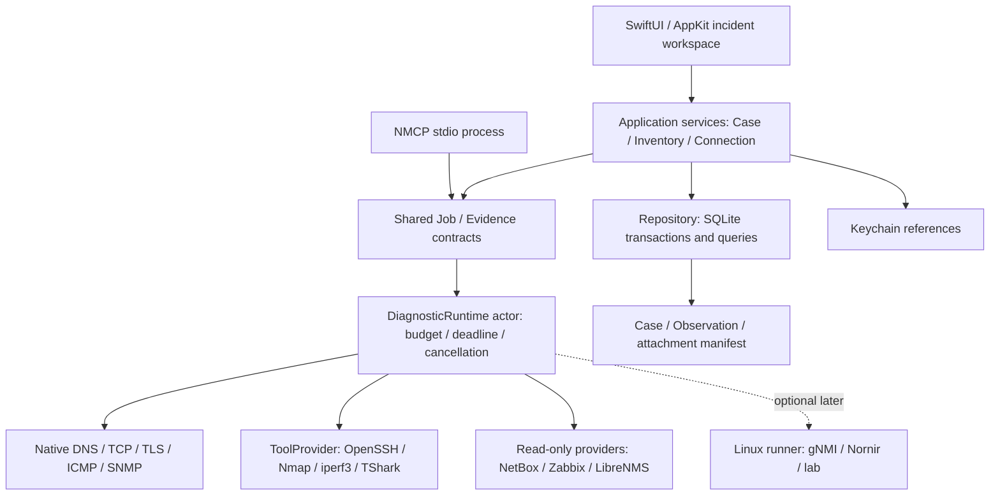

# NETworkManager macOS Next-Generation Architecture and Delivery Plan

[中文方案](NEXT_GENERATION_RESEARCH_2026-11-09.zh-CN.md) · [Document index](README.md) · [Bilingual backlog](NEXT_GENERATION_BACKLOG_2026-11-09.md)

Research baseline: 2026-11-09 (Asia/Shanghai); document revision: 2026-11-10.
Source baseline: [0944345d73df](https://github.com/Nevergoodstudy/NETworkManager-macOS/tree/0944345d73df0eafb2e7353aecca48d924398de8), branch `codex/mcp-server`.

**Status: proposed work.** The reviewed branch contains MCP and UI changes awaiting review in [PR #12](https://github.com/Nevergoodstudy/NETworkManager-macOS/pull/12). “Available in the reviewed code” refers to that commit; it does not mean every capability has reached `main`, passed live-device interoperability, or shipped in a release. This proposal is submitted separately.

**Product goal:** when an incident lands on a Mac, connect its assets, alerts, measurements from different observation points, remote sessions, and operational evidence. Make checks repeatable, changes comparable, and handoffs straightforward.

Keep the native SwiftUI/AppKit application and build on its existing SwiftPM modules. Establish shared execution and evidence foundations, then improve diagnostic confidence, asset identity, and incident workflows. Add terminal, packet, automation, and telemetry capabilities through focused adapters.

## 1. Scope and evidence

This review covers the macOS source architecture, network-engineering incident workflows, related tools, platform APIs, and protocol constraints. External references come from Apple, official project documentation and repositories, and IETF standards. Priorities and architectural choices are proposals that should be tested against real operator scenarios.

The evidence is separated into four categories:

- **Source findings:** repository paths and line numbers point to code that can be inspected.
- **Recorded checks:** existing entries in `PORTING_STATUS.md`; this review did not rerun app tests, live-device interoperability, or distribution validation.
- **Documented capabilities:** `[Sxx]` references support external capabilities and constraints. They do not show that the app implements or interoperates with them.
- **Proposals and targets:** priorities, estimates, performance targets, and product choices need calibration through prototypes and field feedback.

A V2 roadmap dated 2026-11-03 preceded later work on assets, Keychain, SSH, SNMPv3, NetBox/Zabbix, and MCP. This proposal uses the reviewed source baseline rather than carrying old roadmap items forward as requirements. Historical environment notes in the status document do not establish current Git, system, or release state.

## 2. Reviewed baseline and gaps

| Area | Available in reviewed code | Next-stage gap | Source evidence |
|---|---|---|---|
| Native app | SwiftPM, SwiftUI/AppKit, macOS 14 deployment target; GUI, NMCP, NMTest, and NMCheck products | Swift 6.2 toolchain with Swift 5 language mode; domain, UI, execution, and storage boundaries need cleanup | [Package.swift:1-48](https://github.com/Nevergoodstudy/NETworkManager-macOS/blob/0944345d73df0eafb2e7353aecca48d924398de8/macos/Package.swift#L1) |
| Diagnostics | TCP, ICMP, DNS, SNMP, SNTP, WHOIS, traceroute, cancellation, timeouts, and shared DiagnosticService | Cross-page budgets, typed failure reasons, total deadlines, and structured multi-stage results | [DiagnosticService.swift:16-41,184-228](https://github.com/Nevergoodstudy/NETworkManager-macOS/blob/0944345d73df0eafb2e7353aecca48d924de8/macos/Sources/NMCore/DiagnosticService.swift#L16) |
| Assets | Workspace/site/subnet/device records, credential references, source timestamps, history, and recovery | One-address model; no stable external object ID, interface model, multi-address or VRF model, or scalable history store | [Assets.swift:97-117,224-298,391-395,531-538](https://github.com/Nevergoodstudy/NETworkManager-macOS/blob/0944345d73df0eafb2e7353aecca48d924398de8/macos/Sources/NMCore/Assets.swift#L97) |
| External systems | Read-only NetBox preview/merge and Zabbix problem-to-ping/history workflow | Live interoperability, sync diff, metric windows, interface and topology correlation | [NetBox.swift:416-444](https://github.com/Nevergoodstudy/NETworkManager-macOS/blob/0944345d73df0eafb2e7353aecca48d924398de8/macos/Sources/NMIntegrations/NetBox.swift#L416) |
| Remote sessions | System OpenSSH, SwiftTerm, strict host-key interaction, four Cisco IOS read-only templates | Jump hosts, connection plans, workspace recovery, serial, SFTP, and multi-vendor read-only drivers | [EmbeddedSSHView.swift:48-82](https://github.com/Nevergoodstudy/NETworkManager-macOS/blob/0944345d73df0eafb2e7353aecca48d924398de8/macos/Sources/NMRemote/EmbeddedSSHView.swift#L48) |
| MCP | Four local tools and three optional single-target diagnostics with stdio, cancellation, validation, structured output, and a four-job limit | Evidence/workspace authorization, plan schemas, consistent GUI errors, and persisted MCP results | [MCP.md:70-125](https://github.com/Nevergoodstudy/NETworkManager-macOS/blob/0944345d73df0eafb2e7353aecca48d924398de8/macos/MCP.md#L70) |
| Secrets and evidence | Keychain references, redacted export, damaged-data recovery, OSLog events, and limited operation audit | Case/Observation, attachment retention, evidence versions, and structured operation results | [DiagnosticEvidence.swift:3-45](https://github.com/Nevergoodstudy/NETworkManager-macOS/blob/0944345d73df0eafb2e7353aecca48d924398de8/macos/Sources/NMCore/DiagnosticEvidence.swift#L3) |
| Lifecycle and release | SMAppService main-app login item, universal package, and notarization scripts | Minimum OS/Intel validation, real Developer ID, Gatekeeper evidence, and upgrade coverage | [LoginItemManager.swift:17-32,61-80](https://github.com/Nevergoodstudy/NETworkManager-macOS/blob/0944345d73df0eafb2e7353aecca48d924de8/macos/Sources/NMCore/LoginItemManager.swift#L17) |

The recorded local and fixture checks do not substitute for live NetBox/Zabbix systems or SNMP/SSH devices from multiple vendors.

### Four fixes to prioritize

1. **TCP result credibility.** `TCPProbe.connect` drops some `errno`/`SO_ERROR` details and returns `nil`; `probe` maps that to `closed` ([TCPProbe.swift:31-70,74-92](https://github.com/Nevergoodstudy/NETworkManager-macOS/blob/0944345d73df0eafb2e7353aecca48d924398de8/macos/Sources/NMCore/Net/TCPProbe.swift#L31)). This is a code-path risk; no live-network reproduction was attempted. Return `refused`, `timedOut`, `unreachable`, `permissionDenied`, `cancelled`, and `failed` as distinct reasons, and report a port state only when evidence supports it.
2. **Separate system resolution from explicit DNS queries.** `DNSClient.systemServers` merges `/etc/resolv.conf` and `scutil --dns`, then chooses the first server; colon splitting can also damage IPv6 nameservers ([DNS.swift:90-117,162-169](https://github.com/Nevergoodstudy/NETworkManager-macOS/blob/0944345d73df0eafb2e7353aecca48d924de8/macos/Sources/NMCore/Net/DNS.swift#L90)). Keep system-policy resolution and queries to a named server as separate modes. Cover VPN split DNS, `.local`, dual stack, multiple interfaces, and a visible public-DNS fallback choice.
3. **Do not turn failures into empty data.** Some `lsof` and `system_profiler` failures return empty arrays ([SystemNetwork.swift:40-43,163-168](https://github.com/Nevergoodstudy/NETworkManager-macOS/blob/0944345d73df0eafb2e7353aecca48d924398de8/macos/Sources/NMCore/Net/SystemNetwork.swift#L40)). Distinguish empty results, insufficient permissions, missing dependencies, unsupported operations, and execution failures. Local-network permission denial must be recoverable.
4. **Give high-frequency history a transactional store.** `beginDiagnostic` and `finishDiagnostic` save the complete asset/history payload ([Assets.swift:438-454,531-538](https://github.com/Nevergoodstudy/NETworkManager-macOS/blob/0944345d73df0eafb2e7353aecca48d924398de8/macos/Sources/NMCore/Assets.swift#L438)). No benchmark proves a current slowdown; benchmark realistic sizes before high-frequency sampling, then introduce a Repository interface and SQLite migration.

## 3. Product lessons from related tools

| Ecosystem | Established capabilities | Product decision |
|---|---|---|
| Royal TSX, SecureCRT, Termius, iTerm2 [S05-S09] | Session management, credential references, gateways/tunnels, command tasks, serial, dynamic host directories, and workspaces | Bind connections to devices, sites, and incidents; support ProxyJump, controlled forwarding, and workspace recovery. Keep system OpenSSH and add terminal features according to field frequency. |
| NetBox [S10-S11] | Design state, IPAM/DCIM, interface/address relationships, and APIs | Treat the Mac store as an offline overlay and evidence cache. Preserve authoritative values, local overrides, and observations; start with stable IDs and sync diffs. |
| Zabbix and LibreNMS [S12-S14] | Historical metrics, time windows, and link/VLAN/FDB APIs | Show alert-window metrics alongside Mac measurements and label every vantage point, source, and timestamp. |
| Nmap, iperf3, TShark/Wireshark [S15-S18] | Machine-readable service scans, two-ended link tests, and pcapng analysis | Add optional ToolProvider adapters. Parse Nmap XML and iperf3 JSON; start with offline pcapng analysis. Preserve method, tool version, and vantage point. |
| gNMI/OpenConfig, NETCONF, NAPALM/Nornir [S19-S22] | Capability discovery, structured state, subscriptions, device drivers, and candidate configuration workflows | Start with read-only capabilities and facts. Put changes behind an independent ChangePlan and device-specific capability checks. |
| Batfish and containerlab [S23-S24] | Offline differential checks and reproducible lab networks | Use them for lab and release acceptance. Keep macOS as the controller; run labs in a Linux VM or remote Linux host. |
| MCP [S25-S26] | Typed tools, structured output, cancellation, and security boundaries | Connect MCP to explicit Case evidence and diagnostic plans. Enforce scope, budgets, and change authorization in the execution layer. |

## 4. Proposed architecture: native modular app with on-demand adapters



Sharing here means shared code and contracts; it does not give the GUI and multiple NMCP processes one actor or machine-wide budget.

### 4.1 Modules and dependency direction

Gradually extract these boundaries from `NMCore`; do not move every file at once:

| Proposed module | Responsibility | Initial migration points |
|---|---|---|
| `NMDomain` | Sendable values, device identity, Case/Observation/JobSpec, typed errors | Model portions of `Assets.swift` and `DiagnosticService.swift` |
| `NMRuntime` | Scheduling, budgets, cancellation, deadlines, progress events, adapter protocols | DiagnosticService, scanner task logic, MCP diagnostic quota |
| `NMPersistence` | SQLite schema, transactions, migrations, pagination, attachment metadata | AssetStore data operations; UI must not write files directly |
| `NMPlatform` | DNS-SD/Network.framework/CoreWLAN, processes, system capability state | Shell, system network, and resolver code |
| `NMProviders` | NetBox/Zabbix/LibreNMS, tools, and device drivers | Existing integrations and remote adapters |
| Existing UI modules | MainActor view models, navigation, and presentation | NMAssets, NMScanners, NMRemote, and related views |

Keep Domain independent of SwiftUI, file paths, Keychain, and concrete HTTP providers. Let the UI call application services and providers return domain observations. Confine UI work to MainActor and use actors for execution and storage. Enable strict concurrency module by module before considering Swift 6 language mode. Treat `macos/Package.swift` as authoritative for package boundaries [S04].

### 4.2 Job and diagnostic contracts

`JobSpec` should include schemaVersion, jobID, caseID, workspaceID, target identity/address snapshot, probe type and parameters, vantage point, permission scope, total and stage deadlines, target count, concurrency budget, output byte limit, retry policy, creation source, and tool version.

Suggested states are `queued`, `running`, `succeeded`, `partial`, `failed`, `timedOut`, `cancelled`, `permissionDenied`, and `interrupted`. Keep `failureReason` separate for resolution failure, refusal, unreachable network, TLS validation, unsupported protocol, and missing dependency.

Use a monotonic clock for the total deadline, including resolution, address attempts, protocol fallback, and retries. Use UTC wall time to correlate the timeline. Cancellation stops dispatching targets and terminates child processes owned by the job. Bound output bytes and mark truncation. Use bounded event streams, back pressure, and batched UI refreshes for long jobs.

**Process boundary:** keep the visible GUI and client-owned NMCP process as the default. Enforce and document budgets per process. If machine-wide quotas, cross-client ownership, or collection after the window closes become necessary, write a separate ADR for an IPC broker or user service; a Swift actor alone cannot coordinate multiple processes. Consider a narrow XPC interface only for capabilities that clearly require isolation, such as packet capture. A helper is not a way around OS permissions [S01-S02].

### 4.3 Data, identity, and evidence

```text
Workspace → Site → Device → Interface → Address (family / prefix / VRF / zone)
Device ↔ ExternalIdentity(provider, instanceID, objectType, remoteID)
IncidentCase → AlertReference + Job → Observation + ArtifactManifest
ConnectionProfile → Device + CredentialRef + JumpHost/ForwardPolicy
ChangePlan → BeforeSnapshot + Diff + Capabilities + Approval + Postcheck
```

Keep external IDs separate from IP addresses so a device retains history when its address or site changes. Resolve duplicate addresses, multiple VRFs, and cross-source matches rather than merging records by IP alone.

Separate authoritative fields, local overrides, and observations. Preserve `sourceFetchedAt`, `observedAt`, `ingestedAt`, quality, expiry, source, and tool version. Append observations containing the measurement, vantage point, result, failed stage, parameters, and raw-output reference. Represent corrections as a new version or relation; preserve original evidence.

Use tombstones or unlinking for device deletion. Case retention policy governs evidence; deleting a device does not silently cascade through incident history. Show what will be deleted, how long it is retained, and how to clean it up.

Use indexed, transactional, paginated SQLite access with writes managed by a single actor. The GUI owns writes to the primary store; NMCP does not write to it by default. Initially, read evidence from an explicitly selected, redacted Case snapshot. Add persisted integration through an explicit import transaction later.

Migration should back up and validate old JSON, import transactionally into a temporary database, verify counts/relations/constraints, switch over, and retain the original. A failed migration never overwrites original data. For WAL databases, use SQLite’s backup API or a controlled checkpoint; do not copy only the live `.sqlite` main file or put it on a cloud drive/network share [S27].

Store attachments in a dedicated evidence directory; record hash, size, type, collection point, and retention policy in the manifest. Use hashes to check integrity, not to claim provenance or tamper-proof chain of custody. Keep secrets in Keychain and references in the database. Continue using OSLog without writing raw credentials, full configurations, or packets to application logs [S03].

## 5. Workflows worth delivering

### A. Unreachable service: a repeatable diagnostic chain (first priority)

Input a service name or URL and environment. Record interface/VPN/proxy/route context, resolve A/AAAA according to the selected mode, attempt TCP per address family, validate TLS/SNI/certificate, then perform a bounded HTTP check. Show stage duration, failure reason, and evidence.

Make system-proxy and direct-connection paths explicit choices. Attribute a source interface only when the operation was successfully bound to it. A connected VPN does not prove that a probe used the VPN. Constrain redirects by destination policy, hop count, and total deadline; do not collect full response bodies by default.

Distinguish observed facts, possible explanations, and the next check. A successful TCP connection followed by a TLS failure means the connection was established; do not summarize this as a network outage. Preserve both results when IPv6 times out and IPv4 succeeds.

### B. From alert to evidence to handoff (first priority)

Open a Case from a Zabbix alert, associate a stable device identity from NetBox, read the 15/30-minute metric window, run DNS/TCP/Ping/SNMP from the Mac, build a timeline, and export redacted Markdown/JSON with an attachment manifest [S10-S14]. Label each measurement as monitoring server, this Mac, or remote probe, with time and freshness. Allow a standalone Case when an address conflicts or cannot be mapped.

### C. On-site operations and session recovery (second priority)

Use `Device → ConnectionProfile → LaunchPlan` to show jump hosts, target, port, identity reference, known-host state, and tunnel. Build `ProxyJump` and forwarding from argument arrays. Restoring a layout must not send commands.

Start with connection plans, versioned read-only templates, tunnel lifecycle, and serial handoff. Offer iTerm2 Dynamic Profiles as optional output, using stable GUIDs and keeping secrets out of generated files [S05-S09]. Keep interactive terminals distinct from controlled jobs: manually typed commands are not fully audited, while controlled jobs record template ID/version, target, result, and a redacted summary.

### D. Link performance and timing diagnostics (second priority)

Run bounded multi-target Ping/TCP timing checks while the app is open. Show loss, latency distributions, jitter with a documented algorithm, route changes, confidence intervals, and sample count. A non-responsive intermediate hop shows only that the probe received no reply; it does not alone establish forwarding loss.

Use iperf3 as an optional provider, starting with TCP forward/reverse tests. Record both endpoint perspectives, interface context, and version. Tests require a controlled endpoint; a public speed test does not replace end-to-end acceptance [S16].

### E. Evidence-backed topology and deeper analysis (third priority)

Start by importing LibreNMS links, VLAN/FDB data, and NetBox interfaces/cabling; then add on-demand LLDP/SNMP. Store both endpoint ports, physical/logical type, source, timestamp, and conflict state in `TopologyEdge`. Mark stale edges as stale; a scan result alone is not authoritative topology [S10-S14].

Use Nmap XML and distinguish port-table service guesses from active identification. Start with offline pcapng import and installed TShark summary analysis. Live capture requires a separate design for BPF permissions, filters, limits, rotation, and cleanup. Wireshark’s macOS distribution uses ChmodBPF for capture permissions; the current architecture cannot promise full capture without additional permissions [S15,S17-S18].

Gradually replace command-output parsing in the Wi-Fi view with CoreWLAN where its public API provides interfaces, channels, signal, and events. Test SSID/BSSID permissions, OS differences, and hardware support. Do not infer spectrum analysis, roaming control, or management-frame injection from ordinary Wi-Fi APIs [S01,S28].

### F. Evidence-based AI and controlled automation (after the foundations)

Add typed `case_summary`, `evidence_query`, `diagnostic_plan`, and `diagnostic_execute` contracts to the existing MCP foundation. The first evidence query reads only an explicitly selected, redacted Case snapshot. Plans bind client authorization, workspace, target scope, protocol, budget, expiry, and parameter hash. Revalidate in the execution layer; do not grant access based on `readOnlyHint` [S25-S26].

Attach evidence ID, vantage point, collection time, alternative explanations, and the next check to every AI conclusion. Treat DNS/TXT, SNMP descriptions, configurations, and terminal output as untrusted input. A measurement is not a confirmed root cause.

The first gNMI slice should implement Capabilities/Get, followed by bounded Subscribe only when device support is known. Do not expose Set in the first version [S19]. Keep configuration changes in a separate ChangePlan: capability discovery, before snapshot, candidate/diff, pre-check, review, commit, post-check, confirmation or rollback. NETCONF capabilities are optional and rollback behavior differs by platform; do not promise a universal transaction [S20-S22].

Use a versioned JSON contract for a Linux runner, limiting action IDs, device sets, timeouts, concurrency, output, and credential handling. Batfish is suitable for offline differential checks on supported formats; containerlab belongs in a Linux VM or remote Linux host. A successful static model cannot replace verification of real traffic forwarding [S23-S24].

## 6. Executable backlog and phases

Estimates are initial engineering person-days, excluding waits for devices, organizational access, certificates, or interviews. They are not performance or delivery-date promises. The planning model assumes two engineers, one focused on macOS and one on core systems, with shared QA and lab access. A single developer should reduce the 90-day scope to P0 and one complete incident workflow.

The [Markdown backlog](NEXT_GENERATION_BACKLOG_2026-11-09.md), [CSV](NEXT_GENERATION_BACKLOG_2026-11-09.csv), [JSON](NEXT_GENERATION_BACKLOG_2026-11-09.json), and [interactive roadmap](NEXT_GENERATION_ROADMAP_2026-11-09.html) use the same task IDs, dependencies, and estimates. Download the HTML to open it in a browser.

| ID | Priority | Work item | Estimate (days) | Dependencies | Acceptance criteria |
|---|---|---|---:|---|---|
| T01 | P0 | Typed TCP, permission, and dependency failures | 3–5 | — | Distinct refusal, timeout, unreachable, and cancellation outcomes; no empty success for denied permissions. |
| T02 | P0 | Separate system resolution from explicit DNS | 4–7 | T01 | VPN split DNS, IPv6 nameservers, `.local`, and multiple interfaces covered in fixture and real-Mac matrices. |
| T03 | P0 | Job runtime and bounded process adapter | 8–12 | T01 | Total deadlines, budgets, cancellation, output truncation, and cleanup have consistent GUI/MCP semantics. |
| T04 | P0 | Repository and SQLite migration | 8–12 | — | Old JSON migration is verifiable; failures preserve the original; pagination is benchmarked. |
| T05 | P1 | Stable external identity, interfaces, and dual stack | 5–8 | T04 | History survives a remoteID address change; duplicate IPs and VRFs are not merged incorrectly. |
| T06 | P1 | Case/Observation and service diagnostic chain | 8–12 | T02, T03, T04, T05 | Structured DNS→TCP→TLS/HTTP evidence can be restored and exported. |
| T07 | P1 | Zabbix metric windows and incident correlation | 4–7 | T05, T06 | Windows, units, sources, intervals, empty data, permissions, and clock differences are explained. |
| T08 | P1 | ConnectionProfile, LaunchPlan, and jump hosts | 5–8 | T03, T05 | ProxyJump, forwarding, host-key changes, and safe workspace recovery are verified. |
| T09 | P1 | ToolProvider and an iperf3 workflow | 7–10 | T03, T06 | Missing tools, version differences, endpoint perspectives, duration budgets, and cancellation are verified. |
| T10 | P1 | MCP Case snapshots and diagnostic plans | 5–8 | T03, T06 | Scope, budget, and expiry are enforced by the execution layer; schemas align with GUI. |
| T11 | P2 | Read-only LibreNMS/NetBox topology | 6–10 | T05, T06 | Neighbors, ports, sources, timestamps, conflicts, and stale edges are explainable. |
| T12 | P2 | Offline pcapng evidence summaries | 4–7 | T03, T06 | Large/corrupt files, cancellation, hashes, sensitive attachments, and retention are verified. |
| T13 | P2 | Read-only gNMI pilot | 6–10 | T03, T05, T06 | Capabilities/Get, TLS, disconnects, and unsupported models work on two real device families. |
| T14 | P2 | Configuration backup/diff and read-only drivers | 6–10 | T06, T08 | Two OS families are comparable; integrity and redaction pass; writes remain out of scope. |
| T15 | P0 | Real interoperability and formal release gates | 6–10 | — | Real platforms/devices, OS/CPU, upgrades, signing, notarization, and Gatekeeper have evidence. |
| T16 | P1 | Strict concurrency and MainActor/actor boundaries | 4–7 | T03, T04 | Shared mutable-state risk is reduced; cancellation and concurrent fixtures pass. |

The full backlog is not a 90-day commitment. Select T11–T14 as pilots when capacity allows. T15 starts in the first week and continues through the final release build.

### Days 0–30: reliable foundations and a demonstrable slice

Complete T01/T02, progress T03/T04 in parallel, and start T15. Define Job/Observation schemas, fixtures, and error categories in week one; build a minimal service-diagnostic UI. Use sample or isolated data to demonstrate error semantics, cancellation, and migration.

### Days 31–60: close the asset and evidence loop

Complete T05/T06, choose T07 or T08 for an end-to-end scenario, and advance T16 alongside the migration. Deliver “real alert/device → three measurements → timeline → redacted handoff report,” retaining history when a device changes IP.

### Days 61–90: high-value extensions and release acceptance

Prioritize T09/T10 and choose one of T11/T12 if capacity permits. Select gNMI, configuration backup, or native serial as demand-led pilots. Complete platform, protocol, upgrade, and release acceptance. Keep live capture, unattended collection, configuration writes, and team cloud sync out of the core phases.

## 7. A first 10-day iteration

| Days | Reviewable result |
|---|---|
| 1–2 | ADR for status enums, JobSpec, process budgets, and two DNS modes; fixed failure fixtures; two real demo scenarios. |
| 3–4 | Preserve TCP `errno`/`SO_ERROR`; consistent GUI/MCP reasons; refusal, cancellation, and resolution-error fixtures. |
| 5–6 | Separate system resolution and explicit DNS; VPN/dual-stack baseline; visible public-DNS fallback setting. |
| 7–8 | Small DiagnosticRuntime and bounded ProcessAdapter; cancellable DNS→TCP task with event output. |
| 9–10 | TLS/HTTP prototype and Case timeline; record the real-Mac/lab demonstration and revise estimates. |

The first iteration does not require a full SQLite/asset migration. Connect diagnostic contracts to the Repository interface or isolated storage while T04 proceeds in parallel. Label fixture-only demonstrations clearly and record unverified interoperability when test platforms are unavailable.

## 8. Acceptance targets and field test matrix

These are proposed targets. Record hardware, OS, data size, sample count, and p50/p95 in the first benchmark, then adjust thresholds.

- **Diagnostic correctness:** deterministic fixtures for refusal, timeout, unreachable, permission, resolution, TLS, and cancellation; after cancellation no new target is dispatched; a p95 cancellation wait under 500 ms is an initial target.
- **Storage:** indexed pagination for 10,000 devices and 100,000 runs, with a 50-row query p95 target under 200 ms; no full-store encoding on the main thread; failed migration or disk write preserves the original.
- **Evidence:** every result has UTC time, vantage point, source, method, parameters, and version; retained history remains available according to policy after asset deletion; the same external ID does not create a second asset when its address changes.
- **Interoperability:** at least one real NetBox and Zabbix installation and two network OS families for SSH/SNMPv3; RFC vectors are not device compatibility certification [S29-S30].
- **Platform:** macOS 14 and every newer supported version, Apple Silicon and Intel, VPN and multiple interfaces, dual stack, sleep/wake, permission recovery, locked Keychain, missing tools, and paths containing spaces.
- **Process and MCP:** app close, cancellation, MCP EOF, and client disconnect leave no project-owned orphan jobs; multiple NMCP processes do not claim a shared quota; snapshot reads stay within workspace authorization.
- **Secrets:** use canaries across Keychain, logs, profiles, evidence, backups, and exports; configuration and pcap files are sensitive attachments by default.
- **Release:** final universal build, Developer ID, Hardened Runtime, notarization/staple/Gatekeeper, upgrade, and first-run evidence. Existing ad-hoc checks do not establish formal distribution [S31].
- **Product result:** use redacted real incidents to compare handoff completeness, time, context switching, and incorrect conclusions. Do not claim a specific MTTR improvement from this research.

## 9. Architecture decisions and deferred work

| Decision | Proposal | Revisit when |
|---|---|---|
| UI technology | Keep SwiftUI/AppKit; use AppKit locally for terminal and dense tables. | A cross-platform target, team capability, and prototype cost justify a change. |
| Monolith/services | Modular desktop app with protocol/tool/platform adapters. | Remote execution, collaboration, or independent scaling becomes a real requirement. |
| Rust/Go/Python | Do not rewrite protocols for the sake of refactoring; use mature tools/runners where they provide a clear benefit. | Benchmarks or existing driver ecosystems show a durable gain. |
| Background collection | On-demand by default; no new persistent service. | Users explicitly need collection with the window closed and accept its lifecycle. |
| Enterprise source | Connect NetBox/NMS; keep a local offline overlay. | The product becomes an independent IPAM/CMDB with a dedicated team. |
| Packet capture | Offline import and external TShark first; design live capture separately. | Field demand and permission/distribution design are proven. |
| Configuration automation | Facts, backup, and diff first; ChangePlan later. | Driver interoperability, lab coverage, rollback, and review are mature. |
| AI | Evidence summaries, comparison, and next-check plans first. | Deterministic execution policy and approval are mature. |
| Cloud collaboration | Redacted Case packages first; do not sync SQLite or secrets directly. | User frequency, permissions, and retention requirements justify it. |

## 10. Official references

Research cutoff: 2026-11-09. `stable`, `current`, and `latest` URLs may move; pin the version used and retain contract fixtures during implementation. These references support capabilities and constraints; they do not show that this app has been tested with the referenced products in the field.

| ID | Official reference | Decision or constraint |
|---|---|---|
| S01 | [Apple TN3179 — Understanding local network privacy](https://developer.apple.com/documentation/technotes/tn3179-understanding-local-network-privacy) | macOS local-network permission, first failure, retry, and process scope. |
| S02 | [Apple — SMAppService](https://developer.apple.com/documentation/servicemanagement/smappservice) | System-managed login-item and helper lifecycle. |
| S03 | [Apple — Using the keychain to manage user secrets](https://developer.apple.com/documentation/security/using-the-keychain-to-manage-user-secrets) | Keep small secrets in Keychain and references in app data. |
| S04 | [Apple TN3151 — Choosing the right networking API](https://developer.apple.com/documentation/technotes/tn3151-choosing-the-right-networking-api) | Choose between application and lower-level networking APIs. |
| S05 | [Royal TSX — Features](https://www.royalapps.com/ts/mac/features) | Credential references, tasks, gateways, and tunnels. |
| S06 | [SecureCRT — Features](https://www.vandyke.com/products/securecrt/features.html) | macOS sessions, scripts, serial, and forwarding. |
| S07 | [Termius — Modern SSH Client](https://termius.com/) | Workspaces, snippets, SFTP, and forwarding. |
| S08 | [iTerm2 — Dynamic Profiles](https://iterm2.com/documentation-dynamic-profiles.html) | Dynamic external profiles and stable GUIDs. |
| S09 | [iTerm2 — Shell Integration](https://iterm2.com/documentation-shell-integration.html) | Session and command context in a terminal. |
| S10 | [NetBox — Introduction](https://netbox.readthedocs.io/en/stable/introduction/) | IPAM/DCIM source-of-truth boundary. |
| S11 | [NetBox — REST API overview](https://netbox.readthedocs.io/en/stable/integrations/rest-api/) | Object identity, permissions, pagination, and versioning. |
| S12 | [Zabbix — history.get](https://www.zabbix.com/documentation/current/en/manual/api/reference/history/get) | Item IDs, time windows, clock/ns/value history. |
| S13 | [LibreNMS — Switching API](https://docs.librenms.org/API/Switching/) | Links, ports, VLANs, FDB, and source information. |
| S14 | [LibreNMS — Using the API](https://docs.librenms.org/API/) | Authentication and API integration boundary. |
| S15 | [Nmap — XML output](https://nmap.org/book/output-formats-xml-output.html) | Machine interface and service-identification confidence. |
| S16 | [ESnet — Invoking iperf3](https://software.es.net/iperf/invoking.html) | Two-ended model, JSON, direction, bandwidth, duration, concurrency. |
| S17 | [Wireshark — TShark manual](https://www.wireshark.org/docs/man-pages/tshark.html) | pcapng, field output, filtering, rotation, and stop conditions. |
| S18 | [Wireshark — Installing under macOS](https://www.wireshark.org/docs/wsug_html_chunked/ChBuildInstallOSXInstall.html) | ChmodBPF capture permission workflow. |
| S19 | [OpenConfig — gNMI definition](https://github.com/openconfig/gnmi/blob/master/proto/gnmi/gnmi.proto) | Capabilities/Get/Set/Subscribe RPCs; device support requires testing. |
| S20 | [IETF RFC 6241 — NETCONF Protocol](https://www.rfc-editor.org/rfc/rfc6241.html) | Candidate, validate, and confirmed-commit negotiation. |
| S21 | [NAPALM — Supported devices](https://napalm.readthedocs.io/en/latest/support/) | Platform differences in getters, commit, atomicity, and rollback. |
| S22 | [Nornir — Plugins](https://nornir.readthedocs.io/en/latest/plugins/index.html) | Inventory, runner, and task extension boundaries. |
| S23 | [Batfish — Differential questions](https://batfish.readthedocs.io/en/latest/notebooks/differentialQuestions.html) | Baseline/candidate differential checks on supported models. |
| S24 | [containerlab — macOS](https://containerlab.dev/macos/) | Linux VM, network OS images, and CPU architecture constraints. |
| S25 | [MCP — Tools (2025-11-25)](https://modelcontextprotocol.io/specification/2025-11-25/server/tools) | Input/output schema, structured content, and annotations. |
| S26 | [MCP — Security Best Practices (2025-11-25)](https://modelcontextprotocol.io/specification/2025-11-25/basic/security_best_practices) | Authorization, destination/input validation, and execution boundaries. |
| S27 | [SQLite — Write-Ahead Logging](https://sqlite.org/wal.html) | Transaction concurrency, checkpoint, backup, and deployment constraints. |
| S28 | [Apple — Core WLAN](https://developer.apple.com/documentation/corewlan) | Public Wi-Fi interface, event, and capability surface. |
| S29 | [IETF RFC 3414 — SNMPv3 USM](https://www.rfc-editor.org/rfc/rfc3414.html) | Engine/time synchronization, authentication, privacy, and test limits. |
| S30 | [IETF RFC 7860 — HMAC-SHA-2 for SNMP USM](https://www.rfc-editor.org/rfc/rfc7860.html) | Authentication algorithm vectors and implementation checks. |
| S31 | [Apple — Notarizing macOS software before distribution](https://developer.apple.com/documentation/security/notarizing-macos-software-before-distribution) | Developer ID, Hardened Runtime, signing, notarization, and release acceptance. |

## 11. Implementation status and review

All 16 items are proposed work. Implementation links and acceptance records in the tracking issues establish progress. The first review should settle the error taxonomy, the boundary between system resolution and explicit DNS queries, per-process Job budgets, and migration/recovery rules for existing JSON.

Publishing this document establishes a design and task list. App builds, real-device interoperability, data upgrades, performance benchmarks, and formal notarization still need recorded results during implementation. Backlog estimates are not delivery commitments. Keep the Chinese and English proposals and machine-readable backlog aligned when scope changes.
