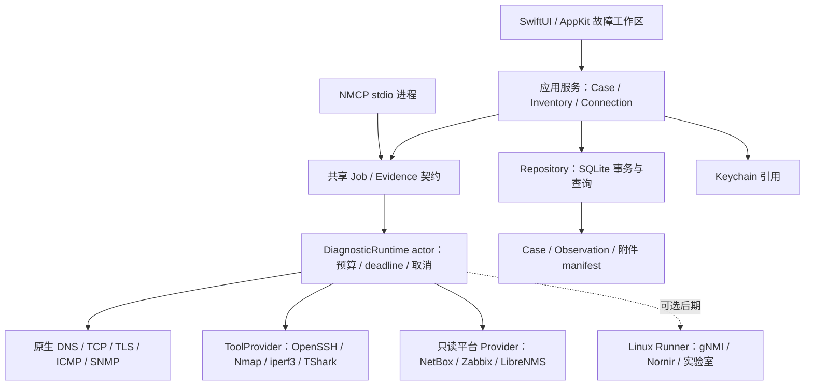

# NETworkManager macOS 下一代架构与实施方案

[English](NEXT_GENERATION_RESEARCH_2026-11-09.en.md) · [文档索引](README.md) · [任务清单](NEXT_GENERATION_BACKLOG_2026-11-09.md)

研究基准：2026-11-09（Asia/Shanghai）；文档修订：2026-11-10。
源码基准：[0944345d73df](https://github.com/Nevergoodstudy/NETworkManager-macOS/tree/0944345d73df0eafb2e7353aecca48d924398de8)，分支 codex/mcp-server。

**状态：待实施的工程提案。** 本文审阅的功能分支包含尚待合并的 [PR #12](https://github.com/Nevergoodstudy/NETworkManager-macOS/pull/12)，包括 MCP 与界面改动。“当前代码具备”指该提交中的实现，不表示这些能力均已进入 main、完成设备互操作或正式发布。本提案独立提交，不合并功能分支。

**建议的产品目标：在 Mac 上打开一个故障，即可把资产、告警、不同观测点的测量、远程会话和操作证据连起来，并能复现检查、比较前后变化、交接给同事。**

保留 SwiftUI/AppKit 原生路线，在现有 SwiftPM 模块上补齐统一执行与证据底座。优先改善诊断可信度、资产身份和故障闭环；终端、抓包、自动化与遥测采用适配器逐步接入。

## 1. 研究范围与证据口径

范围包括 macOS 源码结构、网络工程师的故障处理流程、同类工具、平台 API 和协议约束。外部依据采用 Apple 文档、项目官方文档与仓库、IETF 标准。产品优先级和架构取舍依据这些材料提出，仍需用目标用户的实际案例验证。

证据按以下方式阅读：

- **源码事实**：附仓库路径与行号，可直接复核。
- **历史验证**：来自 `PORTING_STATUS.md` 的既有记录；本轮未重新运行应用测试、真实设备互操作或分发验证。
- **官方能力**：文末 `[Sxx]` 是外部资料支持的能力与约束，不代表本项目已实现或已兼容。
- **建议与目标**：优先级、工期、性能数值、产品取舍均为本次工程提案，需要通过原型与现场反馈校准。

已有 2026-11-03 的 V2 路线图；此后资产、Keychain、SSH、SNMPv3、NetBox/Zabbix、MCP 等已有推进。本方案依据当前源码更新基线，不把旧路线图的待办直接搬成新需求。状态文档包含历史环境描述，当前 Git、系统和发布情况应另行检查，不能由旧记录推定。

## 2. 已审阅的基础与待补齐能力

| 领域 | 当前代码具备 | 下一阶段缺口 | 本地证据 |
|---|---|---|---|
| 原生应用 | SwiftPM、SwiftUI/AppKit、macOS 14 部署目标；独立 GUI/NMCP/NMTest/NMCheck 产品 | 工具链为 Swift 6.2，语言模式仍为 Swift 5；领域、UI、执行和存储边界需整理 | [macos/Package.swift:1-48](https://github.com/Nevergoodstudy/NETworkManager-macOS/blob/0944345d73df0eafb2e7353aecca48d924398de8/macos/Package.swift#L1) |
| 诊断 | TCP/ICMP/DNS/SNMP/SNTP/WHOIS/Traceroute；取消、超时和统一 DiagnosticService | 跨页面任务预算、类型化失败原因、总 deadline、结构化多阶段结果 | [NMCore/DiagnosticService.swift:16-41,184-228](https://github.com/Nevergoodstudy/NETworkManager-macOS/blob/0944345d73df0eafb2e7353aecca48d924398de8/macos/Sources/NMCore/DiagnosticService.swift#L16)；[NMScanners/ScannerView.swift:184-265](https://github.com/Nevergoodstudy/NETworkManager-macOS/blob/0944345d73df0eafb2e7353aecca48d924398de8/macos/Sources/NMScanners/ScannerView.swift#L184) |
| 资产 | Workspace/Site/Subnet/Device、凭据引用、来源抓取时间、统一历史和恢复机制 | 单地址模型；缺稳定外部对象 ID、接口、多地址、VRF；历史规模化 | [NMCore/Assets.swift:97-117,224-298,391-395,531-538](https://github.com/Nevergoodstudy/NETworkManager-macOS/blob/0944345d73df0eafb2e7353aecca48d924398de8/macos/Sources/NMCore/Assets.swift#L97) |
| 外部系统 | NetBox 只读预览/合并；Zabbix 活动问题到 Ping/历史 | 真实平台互操作；同步差异、指标时间窗、接口和拓扑关联 | [NMIntegrations/NetBox.swift:416-444](https://github.com/Nevergoodstudy/NETworkManager-macOS/blob/0944345d73df0eafb2e7353aecca48d924398de8/macos/Sources/NMIntegrations/NetBox.swift#L416)；[PORTING_STATUS.md:107-108,122-123](https://github.com/Nevergoodstudy/NETworkManager-macOS/blob/0944345d73df0eafb2e7353aecca48d924398de8/macos/PORTING_STATUS.md#L107) |
| 远程会话 | 系统 OpenSSH + SwiftTerm；严格主机密钥交互；四条 Cisco IOS 只读模板 | 站点跳板、连接计划、工作区恢复、串口、SFTP 与多厂商只读驱动 | [NMRemote/EmbeddedSSHView.swift:48-82](https://github.com/Nevergoodstudy/NETworkManager-macOS/blob/0944345d73df0eafb2e7353aecca48d924398de8/macos/Sources/NMRemote/EmbeddedSSHView.swift#L48)；[NMRemote/SSHOperations.swift:9-14](https://github.com/Nevergoodstudy/NETworkManager-macOS/blob/0944345d73df0eafb2e7353aecca48d924398de8/macos/Sources/NMRemote/SSHOperations.swift#L9) |
| MCP | 4 个本地工具 + 3 个可选单目标诊断；stdio、取消、参数校验、结构化返回、最多 4 个并发诊断 | 证据与工作区授权、计划 schema、与 GUI 一致的错误语义；当前不保存 MCP 结果 | [macos/MCP.md:70-125](https://github.com/Nevergoodstudy/NETworkManager-macOS/blob/0944345d73df0eafb2e7353aecca48d924398de8/macos/MCP.md#L70)；[NMMCPTools/MCPToolService.swift:137-178](https://github.com/Nevergoodstudy/NETworkManager-macOS/blob/0944345d73df0eafb2e7353aecca48d924398de8/macos/Sources/NMMCPTools/MCPToolService.swift#L137) |
| 秘密与证据 | Keychain 引用、导出脱敏、损坏数据恢复、OSLog 事件、有限操作记录 | Case/Observation、附件保留、证据版本、结构化操作结果；直接终端输入不在完整审计范围 | [NMCore/DiagnosticEvidence.swift:3-45](https://github.com/Nevergoodstudy/NETworkManager-macOS/blob/0944345d73df0eafb2e7353aecca48d924398de8/macos/Sources/NMCore/DiagnosticEvidence.swift#L3)；[NMCore/OperationsAudit.swift:22-54](https://github.com/Nevergoodstudy/NETworkManager-macOS/blob/0944345d73df0eafb2e7353aecca48d924398de8/macos/Sources/NMCore/OperationsAudit.swift#L22) |
| 生命周期与发布 | SMAppService 主应用登录项；Universal 包和正式公证脚本 | 最低系统/Intel/实际升级验证、真实 Developer ID 与 Gatekeeper 发布验收 | [NMCore/LoginItemManager.swift:17-32,61-80](https://github.com/Nevergoodstudy/NETworkManager-macOS/blob/0944345d73df0eafb2e7353aecca48d924398de8/macos/Sources/NMCore/LoginItemManager.swift#L17)；[PORTING_STATUS.md:105-110](https://github.com/Nevergoodstudy/NETworkManager-macOS/blob/0944345d73df0eafb2e7353aecca48d924398de8/macos/PORTING_STATUS.md#L105) |

上表除注明外，源码相对路径均位于 `macos/Sources/`。[PORTING_STATUS.md:97-110](https://github.com/Nevergoodstudy/NETworkManager-macOS/blob/0944345d73df0eafb2e7353aecca48d924398de8/macos/PORTING_STATUS.md#L97) 记录的本机/fixture 通过，不能替代现场 NetBox、Zabbix、多厂商 SNMP/SSH 互操作。

### 最应先做的四项修正

1. **TCP 结果的可信度。** `TCPProbe.connect` 丢弃部分 `errno/SO_ERROR`，返回 `nil`；`probe` 将其统一映射为 `closed`（[Net/TCPProbe.swift:31-70,74-92](https://github.com/Nevergoodstudy/NETworkManager-macOS/blob/0944345d73df0eafb2e7353aecca48d924398de8/macos/Sources/NMCore/Net/TCPProbe.swift#L31)）。这是代码路径风险，本轮没有制造现场网络复现。应返回 `refused/timedOut/unreachable/permissionDenied/cancelled/failed`；只有有充分证据才解释端口状态，不将超时直接写成关闭或过滤。
2. **系统解析与显式 DNS 查询分开。** `DNSClient.systemServers` 合并 `/etc/resolv.conf` 与 `scutil --dns`，随后查询选首个服务器；`nameserver` 文本用冒号拆分也需回归 IPv6（[Net/DNS.swift:90-117,162-169](https://github.com/Nevergoodstudy/NETworkManager-macOS/blob/0944345d73df0eafb2e7353aecca48d924398de8/macos/Sources/NMCore/Net/DNS.swift#L90)）。应保留“按系统规则解析”和“向指定服务器发 DNS 报文”两种模式，补 VPN split DNS、`.local`、双栈和多网卡场景；公有 DNS 回退必须成为可见选择。
3. **运行状态不应伪装为空数据。** `lsof`、`system_profiler` 失败会返回空数组（[Net/SystemNetwork.swift:40-43,163-168](https://github.com/Nevergoodstudy/NETworkManager-macOS/blob/0944345d73df0eafb2e7353aecca48d924398de8/macos/Sources/NMCore/Net/SystemNetwork.swift#L40)）。应区分空结果、权限不足、依赖缺失、不支持和执行失败。Apple 文档说明本地网络权限首次请求可能先失败，之后才收到用户决定；产品需要可恢复状态。[S01]
4. **高频历史存储需要事务底座。** `beginDiagnostic/finishDiagnostic` 每次均保存，`save` 编码整个资产与运行集合（[Assets.swift:438-454,531-538](https://github.com/Nevergoodstudy/NETworkManager-macOS/blob/0944345d73df0eafb2e7353aecca48d924398de8/macos/Sources/NMCore/Assets.swift#L438)）。尚无基准证明当前小数据量卡顿；高频采样前先做数据规模基准、Repository 接口和 SQLite 迁移。

## 3. 外部生态给出的产品判断

| 生态与官方依据 | 已有成熟能力 | 对本项目的决策 |
|---|---|---|
| Royal TSX、SecureCRT、Termius、iTerm2 [S05-S09] | 会话管理、凭据引用、跳板/隧道、命令任务、串口、动态主机目录、工作区等，各产品覆盖不同 | 优先把连接绑定设备/站点/故障，支持 ProxyJump、受控转发、恢复工作区；继续使用系统 OpenSSH。完整终端功能按现场频率逐项选取 |
| NetBox [S10-S11] | 设计状态、IPAM/DCIM、接口/地址关系与 API | 本地是离线覆盖层与观测证据；保留权威字段、用户覆盖和实时值，先做稳定 ID 与差异同步 |
| Zabbix、LibreNMS [S12-S14] | 历史指标与时间窗、现成链路/VLAN/FDB API | 把告警前后 15/30 分钟的指标与 Mac 测量并列；先导入已有拓扑，逐边显示来源与时间 |
| Nmap、iperf3、TShark/Wireshark [S15-S18] | 服务探测的机器输出、两端链路测量、pcapng 协议分析 | 建可选 ToolProvider；Nmap 解析 XML，iperf3 解析 JSON，抓包先离线导入/分析。每条结果保留方法、工具版本与观测点 |
| gNMI/OpenConfig、NETCONF、NAPALM/Nornir [S19-S22] | 能力发现、结构化状态、订阅、设备驱动、候选配置/提交流程 | 先只读 Capabilities/Get/facts；变更放到独立 ChangePlan，按设备能力执行 |
| Batfish、containerlab [S23-S24] | 离线差分检查、可重放实验网络 | 做实验室与发布验收工具；macOS 作为控制端，实验运行在 Linux VM 或远端 Linux |
| MCP [S25-S26] | 类型化工具/结构化结果/取消与安全边界 | 下一步连接证据与排障计划；注解不是权限控制，范围、预算和变更授权由执行层校验 |

这是对公开功能的比较，没有进行竞品安装体验、性能对比、商业规模或付费意愿研究。优先级应在 5–8 名目标工程师的真实故障复盘中校准，重点了解 VPN、双栈、Console、跳板、告警平台与设备品牌的实际比例。

## 4. 建议的架构：模块化原生应用与按需适配器



图中的共享是**代码与契约共享**，不代表 GUI 与多个 NMCP 进程自动拥有同一个 actor 或全机预算。

### 4.1 模块与依赖方向

建议逐步从 `NMCore` 提取以下边界，不一次性移动全部文件：

| 建议模块 | 责任 | 首批迁移入口 |
|---|---|---|
| `NMDomain` | Sendable 领域值、设备身份、Case/Observation/JobSpec、错误枚举 | `Assets.swift`、`DiagnosticService.swift` 的模型部分 |
| `NMRuntime` | 调度、资源预算、取消、总时限、进度事件、适配器协议 | `DiagnosticService`、Scanner 中的任务逻辑、MCP 的诊断配额 |
| `NMPersistence` | SQLite schema/事务/迁移/分页/附件元数据 | `AssetStore` 中的数据操作；UI 不直接写文件 |
| `NMPlatform` | DNS-SD/Network.framework/CoreWLAN、进程与系统能力状态 | `Shell.swift`、`Net/SystemNetwork.swift`、resolver |
| `NMProviders` | NetBox/Zabbix/LibreNMS 与工具、设备驱动 | 现有 `NMIntegrations` 和 Remote adapter |
| 现有界面模块 | MainActor ViewModel、导航与展示 | `NMAssets`、`NMScanners`、`NMRemote` 等保留 |

禁止 Domain 依赖 SwiftUI、文件路径、Keychain 或具体 HTTP Provider。UI 调应用服务；Provider 返回领域观察值。采用 MainActor 约束 UI、actor 管理执行/存储，先逐模块开启严格并发检查，再评估 Swift 6 语言模式。包入口以实际 `macos/Package.swift` 为准。[S04]

### 4.2 Job 与诊断契约

`JobSpec` 至少包含：schemaVersion、jobID、caseID、workspaceID、目标身份/地址快照、probe 类型、参数、观测点、权限作用域、总时限、阶段时限、目标数量、并发预算、输出字节上限、重试策略、创建来源与工具版本。

状态建议：`queued → running → succeeded / partial / failed / timedOut / cancelled / permissionDenied / interrupted`。`failureReason` 独立表示解析失败、连接拒绝、网络不可达、TLS 验证失败、协议不支持、依赖缺失等原因；UI 不再靠英文错误文本决定业务状态。

总 deadline 采用单调时钟，覆盖解析、多地址尝试、协议回退和重试；UTC 墙钟用于关联时间线。取消后停止派发目标并终止属于本任务的子进程；输出有 byte budget 与截断标记。长任务用有界事件流、背压和 UI 批量刷新，避免每个包/采样都触发全视图刷新。

**进程边界决策：**默认继续可见 GUI + 客户端拥有的 NMCP，无常驻采集服务。预算先在各进程独立强制并清楚说明。需要全机统一配额、跨客户端任务所有权或关窗持续采集时，另立 IPC broker/用户服务 ADR；单个 Swift actor 不解决跨进程问题。只有明确需要隔离的抓包/执行能力才评估窄接口 XPC，不能把 helper 当权限绕行手段。[S01-S02]

### 4.3 数据、身份与证据

```text
Workspace → Site → Device → Interface → Address（含 family / prefix / VRF / zone）
Device ↔ ExternalIdentity(provider, instanceID, objectType, remoteID)
IncidentCase → AlertReference + Job → Observation + ArtifactManifest
ConnectionProfile → Device + CredentialRef + JumpHost/ForwardPolicy
ChangePlan → BeforeSnapshot + Diff + Capabilities + Approval + Postcheck
```

- 外部 ID 与 IP 分离；同设备更换 IP/站点仍保留历史。地址重复、多个 VRF、同一设备多来源关联需人工消歧，不只按 IP 合并。
- 将权威字段、本地覆盖字段、观测字段分开。保存 `sourceFetchedAt / observedAt / ingestedAt`，以及质量、过期规则、来源与工具版本。
- `Observation` 为追加式记录：测了什么、从哪里测、结果是什么、哪个阶段失败、参数与原始结果引用。更正采用新版本/关联，不覆盖过去证据。
- 设备删除改为 tombstone/解除关联；证据由 Case 保留策略管理，不随设备记录无声级联删除。先提供明确删除预览、保留期限与清理入口。
- SQLite 加索引、事务、分页；单写入通道以 actor 管理。GUI 拥有主库写入；NMCP 默认仍不写主库。第一阶段通过用户选定的脱敏 Case 快照读证据，后续持久化接入使用显式导入事务。
- 迁移：备份并校验旧 JSON → 临时库事务导入 → 数量/关系/约束检查 → 切换 → 保留原件。失败不覆盖原数据。WAL 数据库备份使用 SQLite 备份机制或受控 checkpoint 流程，不能只复制正在写入的 `.sqlite` 主文件；不把运行库直接放云盘/网络共享。[S27]
- 附件放专用证据目录，manifest 存 hash、大小、类型、采集点和保留策略。hash 用于完整性检测，不宣称证明来源身份或形成防篡改司法链。
- Keychain 仍保存秘密；数据库保存引用。应用诊断日志延续 OSLog，不写原始凭据、完整配置或报文。[S03]

## 5. 最值得交付的功能闭环

### A. 服务连不上：一键生成可复现的诊断链（第一优先）

输入服务域名/URL和环境 → 记录接口/VPN/代理/路由上下文 → 按系统规则解析 A/AAAA → 区分地址族建立 TCP → 验证 TLS/SNI/证书 → 发起受限 HTTP 检查 → 展示各阶段耗时、失败原因与证据。

系统代理路径与直连路径应明确可选；只有显式绑定成功才标注使用某源接口。不能根据“VPN 已连接”就断言某探测经过 VPN。HTTP 跟随跳转受目的地策略/次数/总 deadline 限制；默认不采集完整敏感响应体。

界面区分“已观察到的事实、可能解释、下一项验证”。例如 TCP 成功但 TLS 失败，说明连接已建立；不能直接总结为网络断开。IPv6 超时、IPv4 成功应保留两份结果，不吞掉双栈差异。

### B. 告警到证据到交接（第一优先）

从 Zabbix 告警打开 Case → 通过稳定设备身份关联 NetBox → 读取告警前后 15/30 分钟的已有指标 → 从 Mac 执行 DNS/TCP/Ping/SNMP → 叠加时间线 → 导出脱敏 Markdown/JSON 与附件 manifest。[S10-S14]

必须分别标注“监控服务器”“这台 Mac”“远端探针”的观测点、时间与新鲜度；不同方向的延迟/吞吐不能直接当同一种测量比较。设备 IP 冲突/无法映射时允许独立 Case，不强行关联。历史时间窗指标需明确 item 类型、单位和采样间隔。

### C. 站点现场操作与会话恢复（第二优先）

Device → ConnectionProfile → LaunchPlan，集中显示跳板链、目标、端口、身份引用、已知主机状态与隧道。使用 OpenSSH 参数数组生成 `ProxyJump` 和受控转发；恢复标签页与布局时不自动发送命令。

先补连接计划、只读模板版本、隧道生命周期与串口交接；按用户需求再加 SFTP 或原生 serial provider。iTerm2 动态 Profiles 可作为可选输出，稳定 GUID 对应设备/连接身份，不把秘密写进生成文件。[S05-S09]

人工终端与受控任务分开：终端直接键入命令不宣称全面审计；受控任务保存模板 ID/版本、目标、结果与脱敏摘要。先实现设备 facts、接口、LLDP、配置备份与差异。

### D. 链路性能与时序诊断（第二优先）

应用打开期间运行受限时长的多目标 Ping/TCP 时序检查，显示丢包、时延分布、明确算法的抖动、路径变化与置信区间/采样数。路径中间节点不回复只能说明该探测未得到回复，不能单独判定该节点转发丢包。

iperf3 作为可选测量 Provider，先支持 TCP 正反向，再按实际工具能力增加 UDP/双向。设置时长、带宽与并发流预算；保存客户端/服务端视角、接口上下文和版本。测试需要受控对端服务；公网测速不能替代端到端链路验收。[S16]

### E. 有证据的拓扑与深度分析（第三优先）

先导入 LibreNMS 链路、VLAN/FDB 与 NetBox 接口/线缆关系，再补按需 LLDP/SNMP。用 `TopologyEdge` 保留两端端口、物理/逻辑类型、来源、时间、冲突状态；超期边标记陈旧，不能把扫描结果直接当拓扑。[S10-S14]

Nmap 用 XML 接口；结果区分基于端口表的服务推测与主动识别。抓包先做 pcapng 离线导入和已安装 TShark 的摘要分析；实时捕获随后独立评估 BPF 权限、过滤、时长/容量、轮转与清理。Wireshark 官方 macOS 分发流程通过 ChmodBPF 取得抓包权限，当前应用不能凭现有架构承诺无额外权限的完整抓包。[S15,S17-S18]

Wi-Fi 深度页可逐步以 CoreWLAN 替换大段系统命令文本解析，展示公开 API 可提供的接口/信道/信号/事件；SSID/BSSID 等字段权限、OS 差异、硬件能力必须实测。频谱分析、漫游控制与主动管理帧注入不能由普通 Wi-Fi 信息 API 推定。[S01,S28]

### F. 证据驱动的 AI 与受控自动化（在底座之后）

在已有 MCP 基础上新增 `case_summary / evidence_query / diagnostic_plan / diagnostic_execute` 类型化契约。首版证据查询只读显式选定并脱敏的 Case 快照；执行计划绑定客户端授权、工作区、目标范围、协议、预算、有效期和参数 hash。执行层重新验证，不凭工具 `readOnlyHint` 放行。[S25-S26]

AI 每条结论携带 evidence ID、观测点、采集时间、替代解释及下一项验证；DNS/TXT、SNMP 描述、配置和终端输出始终按不可信数据处理。优先实现摘要、对比和验证计划，测量结果不等于已确认根因。

gNMI 首版只做 Capabilities/Get，之后在资源预算下试点 Subscribe；模型与路径支持按设备确认，不开放 Set。可先用固定版本的可选 runner 验证互操作，再决定 Swift gRPC 接入。[S19]

配置变更单独建立 `ChangePlan`：能力发现 → before snapshot → 候选配置/diff → 预检查 → 审阅批准 → 提交 → 后验证 → 确认或回退。NETCONF 的 candidate/validate/confirmed-commit 是可选能力；NAPALM 的原子性、commit-confirm 和 rollback 依平台而异，不能承诺通用事务回滚。[S20-S22]

Linux runner 使用版本化 JSON 契约，限定 actionID、设备集、超时、并发、输出上限与凭据通道；秘密不放命令参数、持久化任务或普通日志。Batfish 适合支持格式的离线差分验证；containerlab 放 Linux VM/远端，镜像架构和可用性需确认。静态模型通过不能代替真实转发验收。[S23-S24]

## 6. 可执行 backlog 与阶段

工期为初步开发人日，不含等待真实设备、组织接入、证书或产品访谈的时间；也不是对性能或交付日期的承诺。假设 2 名工程师（macOS/核心各 1）及共享 QA/网络实验环境。若只有 1 名开发者，90 天范围应收敛到 P0 与一个完整故障闭环。[Markdown 任务清单](NEXT_GENERATION_BACKLOG_2026-11-09.md)、[CSV](NEXT_GENERATION_BACKLOG_2026-11-09.csv)、[JSON](NEXT_GENERATION_BACKLOG_2026-11-09.json) 和[交互路线看板](NEXT_GENERATION_ROADMAP_2026-11-09.html) 使用相同任务 ID、依赖和估算，可按容量选择范围。HTML 需下载后在浏览器中打开。

| ID | 优先级 | 工作项 | 估算人日 | 依赖 | 完成判据 |
|---|---|---|---:|---|---|
| T01 | P0 | 类型化 TCP/权限/依赖错误 | 3–5 | — | 拒绝、超时、无路由、取消分别返回；权限不足不显示空成功 |
| T02 | P0 | 系统 resolver 与显式 DNS 分离 | 4–7 | T01 | VPN split DNS、IPv6 nameserver、`.local`、多网卡 fixture/实机矩阵 |
| T03 | P0 | Job runtime 与有界进程适配器 | 8–12 | T01 | 总 deadline、进程内预算、取消、输出截断与退出清理贯通 GUI/MCP |
| T04 | P0 | Repository + SQLite 迁移 | 8–12 | — | 旧 JSON 可验证迁移；磁盘失败/中断不破坏原数据；分页可基准测试 |
| T05 | P1 | 稳定外部身份与接口/双栈模型 | 5–8 | T04 | 同 remoteID 换 IP 保留历史；多 VRF/重复 IP 不误合并 |
| T06 | P1 | Case/Observation 与服务诊断链 | 8–12 | T02,T03,T04,T05 | DNS→TCP→TLS/HTTP 结构化证据；关闭重开后可复现并导出 |
| T07 | P1 | Zabbix 指标时间窗与事件关联 | 4–7 | T05,T06 | 告警前后窗口、单位/来源/采样间隔、空数据/权限/时差处理 |
| T08 | P1 | ConnectionProfile/LaunchPlan/跳板 | 5–8 | T03,T05 | ProxyJump/转发启停、主机密钥变化、恢复布局不执行命令 |
| T09 | P1 | ToolProvider + iperf3 纵向切片 | 7–10 | T03,T06 | 缺工具、版本差异、两端正反向、时长预算、取消均可验证 |
| T10 | P1 | MCP Case 快照与排障计划 | 5–8 | T03,T06 | 作用域/预算/过期计划执行层拒绝；结果 schema 与 GUI 一致 |
| T11 | P2 | LibreNMS/NetBox 只读拓扑 | 6–10 | T05,T06 | 邻居/端口/来源/时间、冲突、陈旧边可解释 |
| T12 | P2 | pcapng 离线证据摘要 | 4–7 | T03,T06 | 大/损坏文件、分析取消、hash、敏感附件与保留规则 |
| T13 | P2 | gNMI 只读试点 | 6–10 | T03,T05,T06 | 2 类实际设备的 Capabilities/Get、TLS、断线与不支持模型 |
| T14 | P2 | 配置备份/diff 与只读设备驱动 | 6–10 | T06,T08 | 首批 2 类 OS、完整性与脱敏、前后配置可比；不默认写配置 |
| T15 | P0 | 实机互操作与正式发布 gate | 6–10 | — | 实际平台/设备、支持 OS/CPU、升级、签名公证与 Gatekeeper 证据 |
| T16 | P1 | 严格并发检查与 MainActor/actor | 4–7 | T03,T04 | 分模块消除共享可变状态风险，取消和并行 fixture 通过 |

完整 backlog 不是 90 天必须全部完成的范围；T11–T14 为容量允许时选择的试点。T15 从第一周持续运行，发布完成前仍需复核最终构建。

### 0–30 天：可信底座与可演示切片

完成 T01/T02；T03 与 T04 并行推进；启动 T15。第一周定义 Job/Observation schema、fixture 和错误分类，先做最小服务诊断链 UI。交付使用样例/隔离数据的可操作版本，证明错误语义、取消和迁移方案成立。

### 31–60 天：资产与证据闭环

完成 T05/T06，选择 T07 或 T08 做客户场景贯通，T16 随迁移推进。形成“真实告警/设备 → 三项测量 → 时间线 → 脱敏交接报告”，同时让设备换 IP 后继续关联已有历史。

### 61–90 天：高价值扩展与发布验收

优先 T09/T10，余量在 T11/T12 中选一项；gNMI、配置备份和原生串口按目标用户需求另择试点。完成最终平台/协议/升级/发布验收。实时抓包、无人值守采集、配置写入和团队云同步不与核心阶段捆绑。

## 7. 第一个可启动迭代（建议 10 个工作日）

| 工作日 | 可评审结果 |
|---|---|
| 1–2 | ADR：状态枚举、JobSpec、进程预算、DNS 两种模式；固定失败样例；5–8 名访谈对象与两个真实演示场景 |
| 3–4 | TCP 保留 errno/SO_ERROR；GUI/MCP 显示一致原因；拒绝/取消/解析错误 fixture |
| 5–6 | 系统解析与指定 DNS 分离；VPN/双栈基线；公共 DNS fallback 的可见设置 |
| 7–8 | 小型 DiagnosticRuntime 与有界 ProcessAdapter；一条 DNS→TCP 任务可取消并输出事件 |
| 9–10 | 加 TLS/HTTP 诊断原型和 Case 时间线；真实 Mac/实验环境演示，记录证据；修订后续估算 |

首个迭代不要求整个 SQLite/资产迁移完成；诊断契约先接 Repository 接口或隔离存储，第二条轨道实施 T04。不存在测试设备/平台时，演示明确标记 fixture，保留互操作未验证项。

## 8. 验收指标与真实测试矩阵

以下是建议目标值，首次基准应记录硬件、OS、数据规模、样本数与 p50/p95，再调整门槛。

- **诊断正确性**：拒绝/超时/不可达/权限/解析/TLS/取消均有确定性 fixture；取消后不再派发新目标，应用自己控制的等待取消 p95 目标小于 500 ms。
- **存储**：1 万设备/10 万运行记录的索引分页，50 行查询 p95 目标小于 200 ms；主线程无全库编码；迁移失败/磁盘写失败/异常退出保留原数据。原始高频采样有聚合与保留上限，不无限增长。
- **证据**：每条结果有 UTC 时间、观测点、来源、方法、参数与版本；删除资产后按保留策略仍可查看历史；相同外部 ID 改地址不重复建资产。
- **互操作**：至少真实 NetBox/Zabbix 各一套、两类网络 OS 的 SSH/SNMPv3；按实际使用增加第三厂商与认证算法。RFC 向量不是设备兼容认证。[S29-S30]
- **平台**：最低支持 macOS 14 与实际计划支持的较新版本分别验证；Apple Silicon/Intel、VPN开关、多网卡、双栈、睡眠唤醒、权限拒绝后恢复、Keychain 锁定、缺工具、含空格路径。
- **进程与 MCP**：关闭 App、取消任务、MCP EOF、客户端断开后，无本项目孤儿任务；多个 NMCP 进程不宣称共享配额；快照读取不得越过工作区授权。
- **秘密**：Keychain、日志、profile、证据、配置备份和导出使用 canary 验证；配置/pcap 默认视为敏感附件，摘要可脱敏不代表原件已脱敏。
- **发布**：最终 Universal 构建、Developer ID、Hardened Runtime、公证/staple/Gatekeeper、实际旧数据升级与全新用户首次运行有证据。现有脚本与历史 ad-hoc 验证不等于正式分发已完成。[S31]
- **产品结果**：邀请目标工程师用脱敏真实案例完成“告警→三项验证→交接”；比较点击/切换次数、遗漏证据项、完成时间与误判数量。暂不凭研究给出 MTTR 改善百分比。

## 9. 架构决策与延期项

| 决策 | 本次建议 | 重新评估触发条件 |
|---|---|---|
| UI 技术 | 保留 SwiftUI/AppKit；终端/密集表格局部 AppKit | 有明确跨平台产品目标、团队能力与原型成本数据 |
| 单体/微服务 | 模块化桌面应用；协议/工具/平台适配器 | 远端执行、团队协作或独立伸缩成为真实需求 |
| Rust/Go/Python | 不为重构本身重写协议栈；成熟工具/runner 可选 | 性能基准、协议维护成本或已有驱动生态证明收益 |
| 后台采集 | 默认按需，无新增常驻服务；登录项继续系统托管 | 用户明确需要关窗持续监控，并接受可见服务生命周期 |
| 企业资产源 | 连接 NetBox/NMS，本机离线覆盖层 | 出现独立 IPAM/CMDB 产品定位及专职团队 |
| 抓包 | 先离线导入与外部 TShark；实时捕获独立授权设计 | 高频现场需求得到验证且权限/分发方案通过 |
| 配置自动化 | facts/备份/diff 优先；ChangePlan 后置 | 驱动互操作、实验室、回退与操作审阅已成熟 |
| AI | 证据摘要/比较/下一步计划优先 | 确定性执行策略、设备能力与批准链完善后扩大动作 |
| 云同步/协作 | 先可移交脱敏 Case 包；不直接同步 SQLite/秘密 | 团队用户频率、权限模型和数据保留需求得到验证 |

## 10. 官方资料索引

资料范围截至 2026-11-09。版本化规范按所列版本解释；stable/current/latest 地址可能滚动，实施时应固定实际适配版本并保存合约 fixture。下列资料用于核对能力和约束，不代表本项目已完成相应产品的现场测试。

| 编号 | 官方资料 | 对应决策或约束 |
|---|---|---|
| S01 | [Apple TN3179 — Understanding local network privacy](https://developer.apple.com/documentation/technotes/tn3179-understanding-local-network-privacy) | macOS 15 引入、本地网络权限、用途说明、首次失败与重试、进程归属。 |
| S02 | [Apple — SMAppService](https://developer.apple.com/documentation/servicemanagement/smappservice) | 系统管理的主应用登录项与辅助程序生命周期。 |
| S03 | [Apple — Using the keychain to manage user secrets](https://developer.apple.com/documentation/security/using-the-keychain-to-manage-user-secrets) | 小型秘密存储；资产/证据只保留引用。 |
| S04 | [Apple TN3151 — Choosing the right networking API](https://developer.apple.com/documentation/technotes/tn3151-choosing-the-right-networking-api) | 应用连接与底层/平台网络功能的 API 取舍。 |
| S05 | [Royal TSX — Features](https://www.royalapps.com/ts/mac/features) | 动态数据、凭据引用、任务、SSH gateway/隧道。 |
| S06 | [SecureCRT — Features](https://www.vandyke.com/products/securecrt/features.html) | macOS 会话/脚本/串口/转发；按平台标记判断。 |
| S07 | [Termius — Modern SSH Client](https://termius.com/) | 工作区、Snippets、SFTP、端口转发等公开功能入口。 |
| S08 | [iTerm2 — Dynamic Profiles](https://iterm2.com/documentation-dynamic-profiles.html) | 外部动态配置、稳定 Guid、实时重载。 |
| S09 | [iTerm2 — Shell Integration](https://iterm2.com/documentation-shell-integration.html) | 会话/prompt/命令上下文；任意设备兼容性另测。 |
| S10 | [NetBox — Introduction](https://netbox.readthedocs.io/en/stable/introduction/) | IPAM/DCIM、设计状态、Source of Truth 与非监控边界。 |
| S11 | [NetBox — REST API Overview](https://netbox.readthedocs.io/en/stable/integrations/rest-api/) | 对象身份、权限、分页与版本化接入。 |
| S12 | [Zabbix — history.get](https://www.zabbix.com/documentation/current/en/manual/api/reference/history/get) | itemids、时间窗口、clock/ns/value 历史指标。 |
| S13 | [LibreNMS — Switching API](https://docs.librenms.org/API/Switching/) | 链路/端口/VLAN/FDB、来源与协议。 |
| S14 | [LibreNMS — Using the API](https://docs.librenms.org/API/) | 认证与 API 接入方式，实施时固定版本。 |
| S15 | [Nmap — XML Output](https://nmap.org/book/output-formats-xml-output.html) | 机器接口、服务识别方法与置信度。 |
| S16 | [ESnet — Invoking iperf3](https://software.es.net/iperf/invoking.html) | 两端模型、JSON、正反向、带宽/时长/并发选项；实际安装版本为准。 |
| S17 | [Wireshark — TShark Manual](https://www.wireshark.org/docs/man-pages/tshark.html) | pcapng、JSON/字段输出、过滤、轮转与停止条件。 |
| S18 | [Wireshark — Installing under macOS](https://www.wireshark.org/docs/wsug_html_chunked/ChBuildInstallOSXInstall.html) | 官方 ChmodBPF 捕获权限流程。 |
| S19 | [OpenConfig — gNMI 官方定义](https://github.com/openconfig/gnmi/blob/master/proto/gnmi/gnmi.proto) | Capabilities/Get/Set/Subscribe RPC；设备模型支持另测。 |
| S20 | [IETF RFC 6241 — NETCONF Protocol](https://www.rfc-editor.org/rfc/rfc6241.html) | candidate/validate/confirmed-commit 的能力协商与约束。 |
| S21 | [NAPALM — Supported Devices](https://napalm.readthedocs.io/en/latest/support/) | getters、配置提交/原子性/回退的设备差异。 |
| S22 | [Nornir — Plugins](https://nornir.readthedocs.io/en/latest/plugins/index.html) | inventory/runner/task 的扩展边界。 |
| S23 | [Batfish — Differential Questions](https://batfish.readthedocs.io/en/latest/notebooks/differentialQuestions.html) | 支持模型上的基准/候选差分检查。 |
| S24 | [containerlab — macOS](https://containerlab.dev/macos/) | Linux VM、网络 OS 镜像与 CPU 架构约束。 |
| S25 | [MCP — Tools（2025-11-25）](https://modelcontextprotocol.io/specification/2025-11-25/server/tools) | input/output schema、structuredContent、annotations 的信任边界。 |
| S26 | [MCP — Security Best Practices（2025-11-25）](https://modelcontextprotocol.io/specification/2025-11-25/basic/security_best_practices) | 授权、输入/目的地与执行边界；具体适用项按 stdio/HTTP 传输区分。 |
| S27 | [SQLite — Write-Ahead Logging](https://sqlite.org/wal.html) | 事务并发、WAL/checkpoint 与备份/部署约束。 |
| S28 | [Apple — Core WLAN](https://developer.apple.com/documentation/corewlan) | Wi-Fi client/interface/event 的公开能力。 |
| S29 | [IETF RFC 3414 — SNMPv3 USM](https://www.rfc-editor.org/rfc/rfc3414.html) | 引擎与时间同步、认证/隐私及协议测试边界。 |
| S30 | [IETF RFC 7860 — HMAC-SHA-2 for SNMP USM](https://www.rfc-editor.org/rfc/rfc7860.html) | 认证算法向量与实现检查。 |
| S31 | [Apple — Notarizing macOS software before distribution](https://developer.apple.com/documentation/security/notarizing-macos-software-before-distribution) | Developer ID、Hardened Runtime、签名、公证与分发验收。 |

## 11. 实施状态与评审入口

16 项任务均为计划范围；完成状态以跟踪议题中的实现链接和验收记录为准。第一轮评审需要确定：错误分类是否完整、系统解析与显式 DNS 查询的边界、Job 在各进程内的预算，以及旧 JSON 的迁移与恢复规则。

文档发布只建立设计和任务依据。应用构建、真实设备互操作、数据升级、性能基准和正式公证仍需在实施阶段按第 8 节记录结果。任务清单的估算不代表交付承诺；后续范围调整应同步更新中英文方案与机器可读清单。
